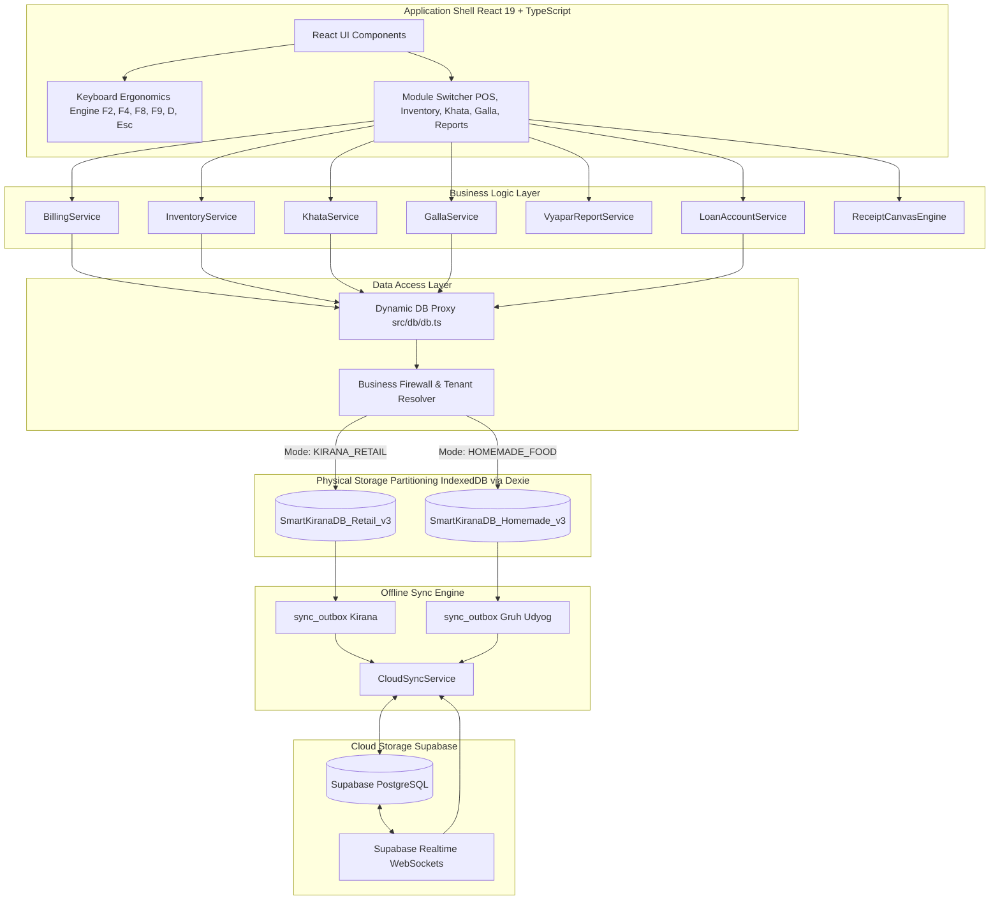
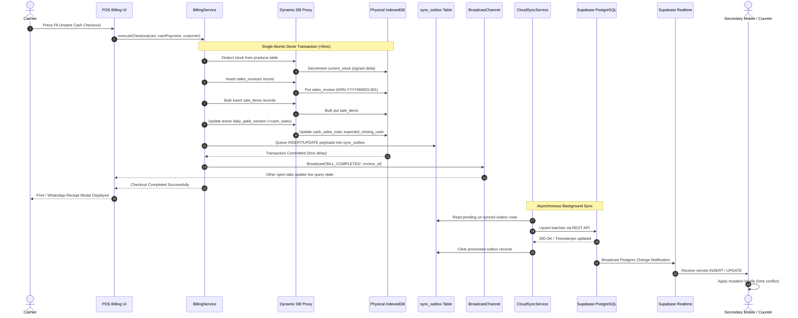
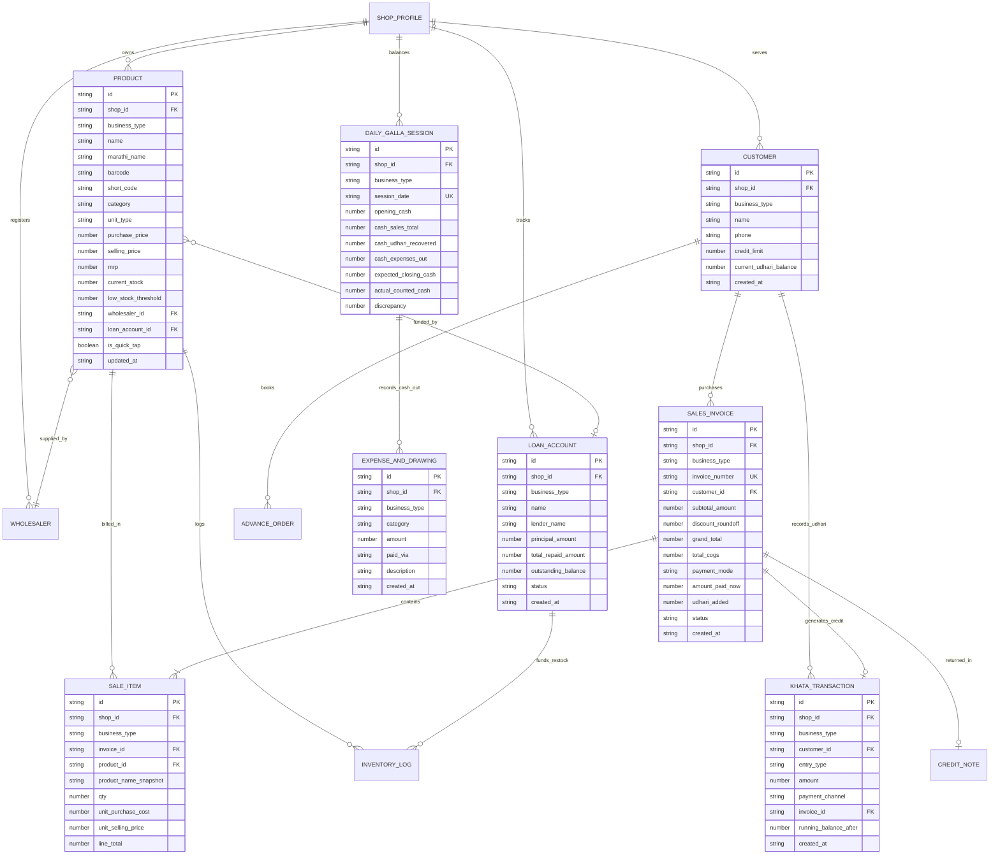

# System Architecture & Technical Design
## Smart Kirana & Gruh Udyog POS Platform

**Version:** 4.0.0 (Enterprise Architecture)  
**Status:** Approved & Implemented in Production  

---

## 1. C4 System Context Diagram

```mermaid
graph TD
    Cashier([Store Cashier / Operator]) -->|Zero-mouse billing, barcode scans| PWA[Smart Kirana PWA]
    Owner([Store Owner / Manager]) -->|P&L reports, Galla audits, PIN overrides| PWA
    Customer([Neighborhood Customer]) <--|WhatsApp receipt slips, SMS reminders| PWA
    
    subgraph Client Device Local Sandbox
        PWA <--> IDB[(Physical IndexedDB Partitioning)]
        PWA <--> BC[BroadcastChannel Multi-Tab Sync]
    end
    
    subgraph Cloud Infrastructure Supabase
        PWA <-->|Bi-directional Sync / Outbox Queue| SupaDB[(Supabase PostgreSQL)]
        PWA <-->|Realtime WebSocket Broadcast| SupaRT[Supabase Realtime Engine]
    end
    
    subgraph External Interfaces
        PWA -->|wa.me deep links| WhatsAppAPI[WhatsApp Web / Mobile]
        PWA -->|Direct sms: URI| TelcoSMS[Carrier SMS Keypad Phones]
    end
```

---

## 2. C4 Container & Component Architecture



---

## 3. High-Speed POS Checkout & Real-Time Sync Sequence



---

## 4. Entity-Relationship (ER) Schema Diagram



---

## 5. Physical Database Partitioning & Dynamic Proxy Pattern

To ensure complete physical data isolation between `KIRANA_RETAIL` and `HOMEMADE_FOOD`:

```typescript
// Physical Database Instantiations
export const kiranaDb = new KiranaDexie('SmartKiranaDB_Retail_v3');
export const homemadeDb = new KiranaDexie('SmartKiranaDB_Homemade_v3');

// Dynamic Proxy Router
export const db = new Proxy({} as KiranaDexie, {
  get(_target, prop: keyof KiranaDexie) {
    const activeBiz = getActiveBusinessType(); // reads localStorage or default
    const activeDatabase = activeBiz === 'HOMEMADE_FOOD' ? homemadeDb : kiranaDb;
    const value = activeDatabase[prop];
    return typeof value === 'function' ? value.bind(activeDatabase) : value;
  }
});
```

### Key Architectural Benefits:
1. **Zero Contamination**: Kirana products, sales, customers, and expenses physically exist in a separate SQLite/IndexedDB file from Gruh Udyog.
2. **Transparent Codebase**: All services and React hooks continue to interact with a single `db` interface without repetitive if-else switching logic.
3. **Coordinated Inter-Business Transfers**: Inter-business inventory movements (e.g., Kirana sugar transferred to the Gruh Udyog kitchen) are coordinated across `kiranaDb` and `homemadeDb` in an atomic sequence with audit logging.
